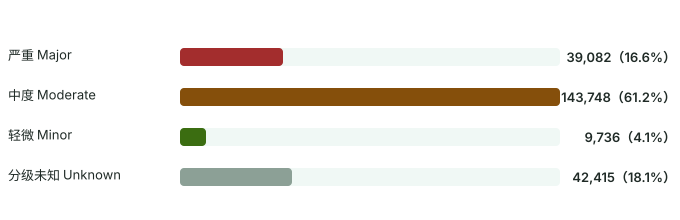
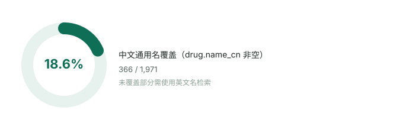
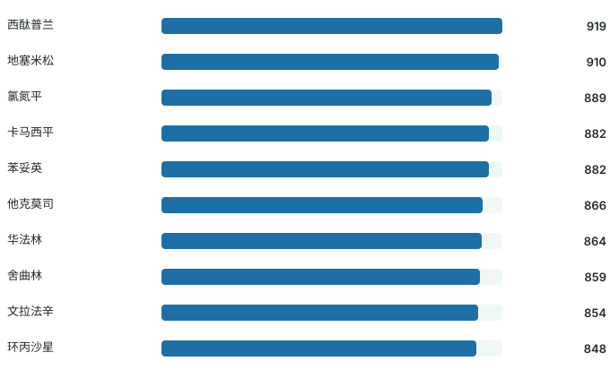
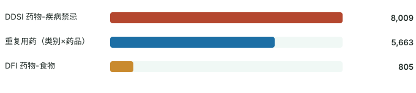

# 数据画像（Data Profile）

> 本文件由 `pipelines/profile_data.py` 从 `data/saferx.sqlite` 直接生成，数字与图表同源，重跑即可更新。
> 数据源：DDInter 2.0（CC BY-NC-SA 4.0），构建时间见 `meta` 表 `built_at`。

## 1. 总体规模

| 指标 | 数值 |
|---|---|
| 药物（drug） | 1,971 种 |
| 唯一药对（ddi，无序对规范化后） | 234,981 对 |
| 中文通用名覆盖 | 366 种（18.6%） |
| 别名总数 | 5,244 条（中文 367、拼音 361、英文 4458、同义 58） |
| 人工审编机制文本 | 21 条（挂接 21 个药对，其余药对仅展示英文原文回退） |

## 2. 风险分级分布



| 分级 | 药对数 | 占比 |
|---|---|---|
| 严重 Major | 39,082 | 16.63% |
| 中度 Moderate | 143,748 | 61.17% |
| 轻微 Minor | 9,736 | 4.14% |
| 分级未知 Unknown | 42,415 | 18.05% |

**解读**：Moderate 占六成，符合审编库「宁可高报不漏报」的收录倾向；`Unknown` 为 DDInter 官方未给出分级的记录，
系统按「分级未知」独立展示，**不并入「安全」**——这是产品诚实性的关键设计。

## 3. 中文名覆盖



中文名来自人工审编的 `data/external/alias_curated.json`（366 种常见药，覆盖心血管、内分泌、抗感染、
精神神经、镇痛、肿瘤等 20 余个治疗领域），拼音首字母由 `pypinyin` 自动生成。
未覆盖的 1,605 种药仍需使用英文通用名检索——这是审编库的覆盖边界，界面已明确提示。

## 4. 高连接度药物 Top 10



| # | 中文名 | 英文名 | 关联药对数 | 其中 Major |
|---|---|---|---|---|
| 1 | 西酞普兰 | Citalopram | 919 | 263 |
| 2 | 地塞米松 | Dexamethasone | 910 | 106 |
| 3 | 氯氮平 | Clozapine | 889 | 417 |
| 4 | 卡马西平 | Carbamazepine | 882 | 185 |
| 5 | 苯妥英 | Phenytoin | 882 | 177 |
| 6 | 他克莫司 | Tacrolimus | 866 | 216 |
| 7 | 华法林 | Warfarin | 864 | 133 |
| 8 | 舍曲林 | Sertraline | 859 | 138 |
| 9 | 文拉法辛 | Venlafaxine | 854 | 137 |
| 10 | 环丙沙星 | Ciprofloxacin | 848 | 139 |

**解读**：连接度最高的并非「最危险」的药，而是代谢通路枢纽（CYP450 底物/抑制剂/诱导剂）与
治疗窗窄的药物（华法林、他克莫司、苯妥英、卡马西平）。这类药物正是临床处方审核的重点对象，
也解释了为什么「药单整体检查」比单药查询更有价值。

## 5. 其他相互作用（DDSI / DFI / 重复用药）

DDInter 官方只对 DDI 提供 CSV 下载，这三类仅以网页表格形式开放。项目通过逆向其 DataTables
接口分页抓取（方法与复现命令见 `data_dictionary.md` §2.1），清洗后入库：



| 类别 | 入库条目 | 覆盖范围 | 分级分布（Major / Moderate / Minor） |
|---|---|---|---|
| DDSI 药物-疾病禁忌 | 8,009 | 459 种基础疾病 × 1,391 种药 | 3,570 / 4,359 / 80 |
| DFI 药物-食物 | 805 | 29 类食物 / 烟酒 × 680 种药 | 92 / 677 / 36 |
| 重复用药 | 5,663 | 95 个治疗类别 × 649 种药 | 不分级（同类 ≥2 种即告警） |

**Top 8 基础疾病（按禁忌条目数）**

| 疾病 | 条目数 | 其中 Major |
|---|---|---|
| 肾脏疾病 | 641 | 225 |
| 肝脏疾病 | 638 | 271 |
| 糖尿病 | 185 | 33 |
| 抑郁症 | 154 | 72 |
| 肝功能不全 | 149 | 27 |
| 感染 | 146 | 82 |
| 心血管疾病 | 142 | 85 |
| 低血压 | 127 | 75 |

**Top 8 食物 / 饮品**

| 食物 | 条目数 | 其中 Major |
|---|---|---|
| 酒精 | 433 | 35 |
| 西柚汁 | 137 | 42 |
| 高脂食物 | 66 | 3 |
| 食物（泛指） | 60 | 1 |
| 高钾食物 | 17 | 0 |
| 乳制品 | 16 | 0 |
| 富含酪氨酸的食物 | 11 | 8 |
| 咖啡 | 10 | 0 |

**Top 8 重复用药类别**

| 治疗类别 | 条目数 |
|---|---|
| 抗组胺药 | 1,613 |
| 非甾体抗炎药 | 867 |
| 抗胆碱能 / 解痉药 | 482 |
| 吸入性支气管扩张剂 | 207 |
| 噻嗪类利尿剂 | 162 |
| 抗抑郁药 | 157 |
| 拟交感胺类 | 147 |
| 安定类（镇静剂） | 145 |

**解读**：

- 疾病侧「肾脏疾病 / 肝脏疾病」条目最多（各 640 条量级），与药代动力学常识一致——肝肾功能决定
  多数药物的清除，是最需要先问的病史；中文病名覆盖 150/459 种，但已覆盖 88.8% 的条目。
- 食物侧高度集中在酒精（433 条）与西柚汁（137 条），二者占 70.8%——不是数据贫乏，而是真实临床
  关注点本来就集中在这两项（CYP3A4 抑制、中枢抑制叠加、双硫仑样反应）。
- 重复用药条目数最多的是抗组胺药（1,613 条）与非甾体抗炎药（867 条），恰是感冒药与止痛药里
  最容易「一药多名、重复服用」的品类，与「患者自行加药」的现实风险吻合。

## 6. 数据质量与处理规则
| 问题 | 处理方式 |
|---|---|
| 同一药对在多个分类文件中重复出现 | 以 `(min(id_a,id_b), max(id_a,id_b))` 规范化后去重 |
| 同一药对分级冲突 | 取最高风险等级（Major > Moderate > Minor > Unknown） |
| 官方 `Unknown` 分级（42,415 对） | 保留并单独展示，不视为无风险 |
| 药名写法差异（Aspirin / Acetylsalicylic acid、Glibenclamide / Glyburide） | 别名表登记同义词 |
| 拼音首字母天然冲突（如 klms） | 冲突项不做映射，提示改用中文全名 |
| 官方 CSV 不含机制文本 | 人工审编 21 条经典机制；其余显示「暂无中文机制」并保留英文原文位 |
| 网页接口无 CSV、需绕过 CSRF 分页 | 抓取脚本带 token + 分页 POST，落盘原始 JSONL 快照备查 |
| DFI 源接口把 mechanism 字段误命名为 magnesium | 清洗时按语义归位，字段名以本库为准 |

## 7. 复现方式

```bash
python pipelines/profile_data.py     # 重新生成图表与本文件
```
